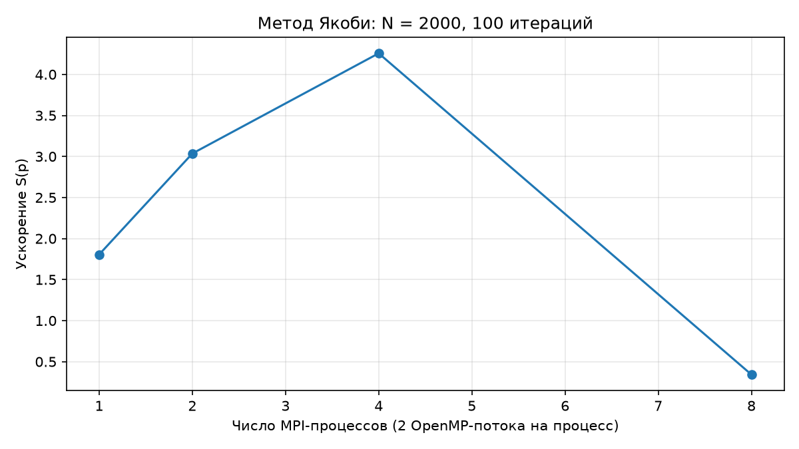
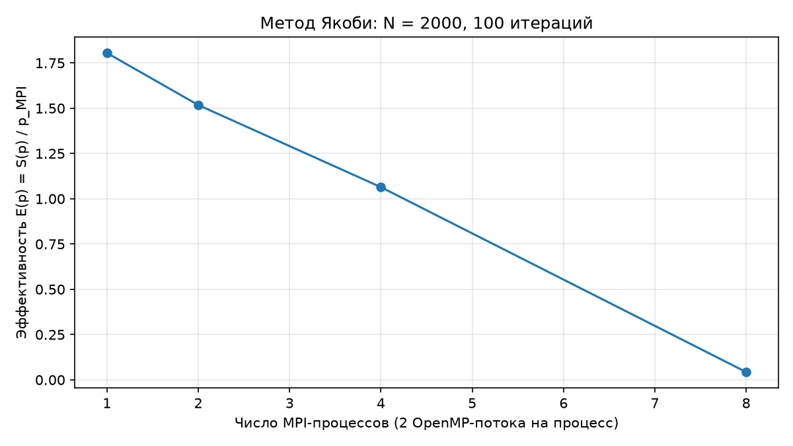
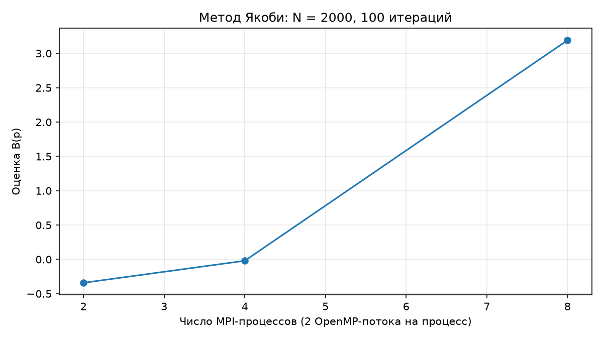
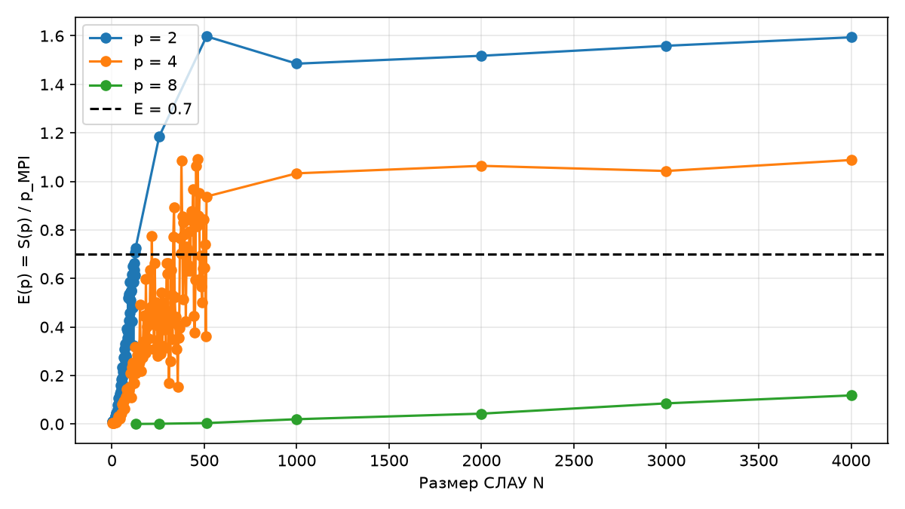

# Лабораторная работа №1 — вариант 22

Решение СЛАУ методом Якоби: MPI + OpenMP

Дата: 8 ноября 2026 года. ФИО, группа и преподаватель: поля титула для заполнения.

## 1. Введение и постановка задачи

Цель работы — реализовать решение системы линейных алгебраических уравнений методом Якоби с использованием MPI и OpenMP и экспериментально исследовать ускорение, эффективность и масштабируемость гибридной программы.

Задание варианта 22: реализовать параллельное решение СЛАУ методом Якоби с использованием MPI + OpenMP. Для N=2000 выполнить 100 итераций и измерить время на 1, 2, 4, 8 MPI-процессах. Построить E(p). Для E=0.7 найти N_min при p=2,4,8. Каждый набор измеряется не менее трёх раз; ввод-вывод исключается.

Вход — плотная случайная матрица A, правая часть b. Генератор с seed=22 создаёт внедиагональные коэффициенты в [-1,1], затем задаёт a_ii=1+Σ(j≠i)|a_ij|. Таким образом, диагональное преобладание строгое. Случайный вектор x* задаёт b=A·x*. Начальное приближение x^(0)=0. Все режимы получают воспроизводимые данные.

## 2. Теоретическая часть

Метод Якоби использует значения только предыдущей итерации. Формула обновления строки i: x_i^(k+1) = [b_i − Σ(j≠i) a_ij·x_j^(k)] / a_ii. При строгом диагональном преобладании выбранного семейства систем итерационный процесс сходится. Для выполнения задания остановка по точности не применяется: всегда выполняются ровно 100 шагов.

Одна итерация плотной системы требует O(N²) арифметических действий. Строки независимы при известном x^(k); их можно распределить между MPI-процессами и OpenMP-потоками. После каждого шага всем процессам нужен полный новый вектор. MPI обеспечивает межпроцессные обмены, а prange в Numba распределяет независимые локальные строки между потоками OpenMP.

Метрики задания: S(p)=T1/Tp; E(p)=S(p)/p; B(p)=[1/S(p)−1/p]/[1−1/p], p>1. Закон Амдала: S_A(p)=1/[B+(1−B)/p]. Здесь p обозначает число MPI-процессов; в каждом процессе два OpenMP-потока. Поэтому дополнительно вычисляется E_total=S/(2p). S и E по процессам могут превышать p и 1 соответственно. B в такой гибридной конфигурации является формальной оценкой модели, а не физической долей строк программы.

## 3. Описание алгоритма MPI и OpenMP

Процесс rank=0 генерирует A,b. Матрица и правая часть распределяются двумя Scatter на равные непрерывные блоки N/p строк. Каждый процесс хранит свои строки и полный старый вектор x. На каждом из 100 шагов jacobi_rows с @njit(parallel=True) и prange вычисляет локальные компоненты нового вектора. Allgather собирает их на всех процессах. Только после завершения обмена начинается следующий шаг; чтение и запись одного поколения x не смешиваются.

Схема: генерация A,b → Scatter строк → x=0 → [prange обновления строк → Allgather нового x] × 100 → проверка → расчёт метрик → сохранение. Для OpenMP до первой компиляции установлен NUMBA_THREADING_LAYER=omp, после запуска записывается numba.threading_layer(). Во всех измерениях фактически выбран omp.

Последовательный метод также JIT-компилируется Numba, но использует обычные циклы range и один поток. Арифметическая формула и порядок суммирования одинаковы. Это уменьшает влияние различий Python/NumPy/JIT на сравнение. Проверка входа требует положительных размеров, делимости N на p, не менее трёх повторов и минимум двух OpenMP-потоков на процесс.

## 4. Реализация и методика эксперимента

main.py содержит generate_data, sequential_computation, parallel_computation, check_result и main. run_experiments.py выполняет MPI-серии и поиск минимального размера; plot_graphs.py читает фактические CSV. Полный исходник основной программы приведён в приложении; вспомогательные скрипты находятся рядом с отчётом.

Среда измерения: Windows, Intel Core i5-11400F (6 физических / 12 логических ядер), Python 3.12.14, NumPy 2.5.4, Numba 0.68.0, Microsoft MPI 10.1.12498.52. Дата экспериментов — 8 ноября 2026 года. На каждый MPI-процесс выделено 2 OpenMP-потока; BLAS-потоки ограничены одним. В основной серии p=1,2,4,8, N=2000, 100 итераций, три повтора.

Оба JIT-ядра предварительно прогреты на малой системе вне измеряемого участка. T1 измеряется perf_counter, Tp — MPI.Wtime после Barrier. Tp включает выделение локальных буферов, Scatter и 100 обновлений с Allgather. Для каждого повтора берётся максимальное время по rank, затем среднее по трём повторам. Генерация, вычисление невязки и запись файлов исключены. Запуск mpiexec и импорт модулей также происходят до измерений.

## 5. Экспериментальные результаты

| p | T1, с | Tp, с | S(p) | E(p) | B(p) |
| --- | --- | --- | --- | --- | --- |
| 1 | 0.444226 | 0.246082 | 1.8052 | 1.8052 | — |
| 2 | 0.442868 | 0.145897 | 3.0355 | 1.5177 | -0.3411 |
| 4 | 0.433872 | 0.101931 | 4.2565 | 1.0641 | -0.0201 |
| 8 | 0.458604 | 1.338126 | 0.3427 | 0.0428 | 3.1918 |

Во всех четырёх режимах результат совпал с последовательным решением. Максимальная абсолютная ошибка относительно x*: 2.442491·10⁻¹⁵; относительная невязка ||Ax−b||∞/||b||∞: 2.295382·10⁻¹⁵. Это подтверждение для выбранных входов; дополнительные системы проверяются отдельными тестами.







## 6. Исследование масштабируемости

Сначала проверена сетка N=128,256,512,1000,2000,3000,4000. Если E>=0.7 достигнута, дополнительно проверяются все меньшие допустимые N с шагом p. Каждый размер измерен трижды при 100 итерациях. Всего получено 216 комбинаций N,p, то есть 648 параллельных измерений; во всех комбинациях correct=True.

| p | N_min серии | E(N_min) | Граница вывода |
| --- | --- | --- | --- |
| 2 | 124 | 0.7078 | Все меньшие N, кратные p, проверены |
| 4 | 216 | 0.7756 | Все меньшие N, кратные p, проверены |
| 8 | Не найден | — | 7 точек сетки до N=4000 |

N_min — экспериментальный минимум этой серии среди допустимых размеров, кратных p. Короткие времена чувствительны к шуму, и повторный эксперимент может дать другой минимум; монотонность эффективности не предполагается. Для p=8 условие на проверенной сетке не выполнено. Отсюда нельзя вывести, что порог невозможен при любых размерах. Все размеры и отдельные времена сохранены в scalability.csv и JSON, включая уточняющие серии.



## 7. Анализ результатов

При N=2000 минимальное измеренное время Tp получено при p=4: 0.101931 с, S=4.2565. При p=1 задействованы два OpenMP-потока, поэтому S(1)>1 не противоречит измерениям. E_total для p=1,2,4,8 соответственно равна 0.9026, 0.7589, 0.5321, 0.0214.

Для p=2 и p=4 B отрицательна вследствие гибридной модели с двумя потоками на процесс; интерпретировать её как отрицательную долю последовательных инструкций нельзя. При p=8 B>1 отражает замедление относительно последовательного метода. Запускаются 16 потоков при 12 логических ядрах, возрастает конкуренция за вычислительные ресурсы и память; обмены Allgather повторяются 100 раз. Это вероятные факторы деградации. Отдельное профилирование каждого фактора не выполнялось.

В основной серии наибольшее T1 меньше 0.5 с, существенно ниже ограничения 30 с для N<=2048. Каждый процессный запуск всей грубой серии завершился раньше пяти минут. Теоретические диапазоны ускорения из примера методички не подменяют фактические измерения конкретной гибридной конфигурации.

## 8. Проверка корректности и обработка ошибок

test_jacobi.py запущен на p=1,2,4,8. Он независимо сравнивает с numpy.linalg.solve обычную и диагональную системы и нулевую правую часть, проверяет первую итерацию по b_i/a_ii и согласованный отказ при неделимом N. Пройдено 19 из 19 сценариев. Нулевое число повторов и неделимый размер в CLI приводят к сообщению и ненулевому коду завершения. Сохранение JSON выполняется rank=0, ошибка ввода-вывода обрабатывается общим обработчиком и завершает MPI-задание.

## 9. Выводы

Разработана и проверена реализация метода Якоби с MPI-разбиением строк и реальным OpenMP через Numba. Выполнены обязательные 100 итераций для N=2000 на 1,2,4,8 процессах, по три повтора. Решения корректны; построены S,E,B и масштабируемость. В проведённой серии N_min равен 124 при p=2 и 216 при p=4; для p=8 он не установлен на проверенной сетке до 4000. Для выбранной основной задачи лучшим из проверенных режимов стал p=4. При интерпретации необходимо учитывать два потока на процесс и аппаратные ограничения.

## Список литературы

1. Методические указания «ЛР1. PYTHON + MPI + OpenMP», предоставленный файл; индивидуальное задание — вариант 22.

2. mpi4py. Tutorial: коллективные операции с NumPy-массивами. https://mpi4py.readthedocs.io/en/stable/tutorial.html (дата обращения: 08.11.2026).

3. Numba. The Threading Layers; переменные окружения. https://numba.readthedocs.io/en/stable/user/threading-layer.html и https://numba.readthedocs.io/en/stable/reference/envvars.html (дата обращения: 08.11.2026).

## Приложение. Полный текст основной программы

```python
"""ЛР1, вариант 22: метод Якоби, MPI и подтверждённый OpenMP Numba."""
from __future__ import annotations

import argparse
import json
import os
import platform
import time
from pathlib import Path

# Выбор backend должен предшествовать первой компиляции parallel=True.
os.environ['NUMBA_THREADING_LAYER'] = 'omp'
os.environ.setdefault('NUMBA_NUM_THREADS', str(os.cpu_count() or 2))
os.environ.setdefault('OPENBLAS_NUM_THREADS', '1')
os.environ.setdefault('MKL_NUM_THREADS', '1')

import numpy as np
import numba
from mpi4py import MPI
from numba import njit, prange

ROOT = Path(__file__).resolve().parent


def generate_data(n: int, seed: int = 22) -> tuple[np.ndarray, np.ndarray, np.ndarray]:
    """Создать строго диагонально преобладающую СЛАУ с известным решением."""
    if n < 1:
        raise ValueError('N должен быть положительным')
    rng = np.random.default_rng(seed)
    a = rng.uniform(-1.0, 1.0, (n, n))
    np.fill_diagonal(a, 0.0)
    np.fill_diagonal(a, np.abs(a).sum(axis=1) + 1.0)
    exact = rng.uniform(-1.0, 1.0, n)
    b = a @ exact
    return a, b, exact


@njit(cache=True)
def sequential_kernel(a, b, iterations):
    """Выполнить заданное число итераций Якоби одним потоком."""
    n = len(b)
    x = np.zeros(n)
    new = np.empty(n)
    for _ in range(iterations):
        for i in range(n):
            total = 0.0
            for j in range(n):
                if j != i:
                    total += a[i, j] * x[j]
            new[i] = (b[i] - total) / a[i, i]
        x, new = new, x
    return x


@njit(parallel=True, cache=True)
def jacobi_rows(a, b, old, new, offset):
    """Обновить независимые строки блока через OpenMP prange."""
    for i in prange(len(b)):
        global_i = offset + i
        total = 0.0
        for j in range(len(old)):
            if j != global_i:
                total += a[i, j] * old[j]
        new[i] = (b[i] - total) / a[i, global_i]


def sequential_computation(data, iterations: int = 100):
    """Последовательно решить СЛАУ тем же арифметическим ядром."""
    a, b = data[:2]
    return sequential_kernel(a, b, iterations)


def parallel_computation(data, comm, iterations: int = 100):
    """Scatter строк, локальный Якоби, Allgather нового x на каждом шаге."""
    rank, p = comm.Get_rank(), comm.Get_size()
    n = comm.bcast(len(data[1]) if rank == 0 else None, root=0)
    if n < p or n % p:
        raise ValueError('N должен делиться на число MPI-процессов и быть не меньше p')
    rows = n // p
    a = np.empty((rows, n), dtype=np.float64)
    b = np.empty(rows, dtype=np.float64)
    comm.Scatter(data[0] if rank == 0 else None, a, root=0)
    comm.Scatter(data[1] if rank == 0 else None, b, root=0)
    x = np.zeros(n, dtype=np.float64)
    local_x = np.empty(rows, dtype=np.float64)
    for _ in range(iterations):
        # Все строки используют x только предыдущей итерации.
        jacobi_rows(a, b, x, local_x, rank * rows)
        comm.Allgather(local_x, x)
    return x


def check_result(seq_result, par_result, eps: float = 1e-9) -> bool:
    """Сравнить векторы, отвергая NaN и бесконечности."""
    return bool(np.isfinite(par_result).all() and
                np.allclose(seq_result, par_result, rtol=eps, atol=eps))


def run_measurements(n: int, iterations: int, repeats: int, comm):
    """Усреднить замеры; Tp включает распределение данных и все обмены."""
    rank, p = comm.Get_rank(), comm.Get_size()
    data = generate_data(n) if rank == 0 else None
    # Прогреть оба JIT-ядра на малом входе, вне измерений.
    small = generate_data(8 * p) if rank == 0 else None
    if rank == 0:
        sequential_computation(small, 1)
    parallel_computation(small, comm, 1)
    seq_times, par_times = [], []
    for repeat in range(repeats):
        comm.Barrier()
        if rank == 0:
            start = time.perf_counter()
            seq = sequential_computation(data, iterations)
            seq_times.append(time.perf_counter() - start)
        comm.Barrier()
        start = MPI.Wtime()
        par = parallel_computation(data, comm, iterations)
        elapsed = MPI.Wtime() - start
        # Время всего задания определяется самым медленным rank.
        par_times.append(comm.allreduce(elapsed, op=MPI.MAX))
    if rank != 0:
        return None
    a, b, exact = data
    t1, tp = float(np.mean(seq_times)), float(np.mean(par_times))
    speedup = t1 / tp
    relative_residual = float(np.linalg.norm(a @ par - b, ord=np.inf) /
                              np.linalg.norm(b, ord=np.inf))
    error = float(np.max(np.abs(par - exact)))
    correct = check_result(seq, par) and error < 1e-8 and relative_residual < 1e-9
    return dict(n=n, iterations=iterations, processes=p,
                threads_per_process=numba.get_num_threads(),
                total_threads=p * numba.get_num_threads(),
                threading_layer=numba.threading_layer(),
                t1_seconds=t1, tp_seconds=tp, speedup=speedup,
                efficiency=speedup / p,
                efficiency_total_threads=speedup / (p * numba.get_num_threads()),
                serial_fraction_b=(1 / speedup - 1 / p) / (1 - 1 / p) if p > 1 else None,
                max_abs_error=error, relative_residual=relative_residual,
                correct=correct, repeats=repeats,
                sequential_samples=seq_times, parallel_samples=par_times,
                python=platform.python_version(), numpy=np.__version__,
                numba=numba.__version__, mpi_library=MPI.Get_library_version().strip())


def main():
    """Разобрать CLI, проверить параметры и сохранить измерения в JSON."""
    parser = argparse.ArgumentParser(description='ЛР1, вариант 22: метод Якоби')
    parser.add_argument('--n', type=int, default=2000)
    parser.add_argument('--sizes', nargs='+', type=int)
    parser.add_argument('--iterations', type=int, default=100)
    parser.add_argument('--repeats', type=int, default=3)
    parser.add_argument('--threads', type=int, default=2)
    parser.add_argument('--output', type=Path)
    args = parser.parse_args()
    comm = MPI.COMM_WORLD
    try:
        sizes = args.sizes or [args.n]
        if args.iterations < 1 or args.repeats < 3 or args.threads < 2:
            raise ValueError('Нужны iterations >= 1, repeats >= 3, threads >= 2')
        if any(n < comm.size or n % comm.size for n in sizes):
            raise ValueError('Каждый N должен быть положительным и делиться на p')
        numba.set_num_threads(args.threads)
        results = []
        for n in sizes:
            result = run_measurements(n, args.iterations, args.repeats, comm)
            if comm.rank == 0:
                results.append(result)
                print(json.dumps(result, ensure_ascii=False), flush=True)
                if not result['correct']:
                    raise RuntimeError('Проверка результата: ОШИБКА')
        if comm.rank == 0 and args.output:
            args.output.parent.mkdir(parents=True, exist_ok=True)
            args.output.write_text(json.dumps(results, ensure_ascii=False, indent=2), encoding='utf-8')
    except Exception as exc:
        if comm.rank == 0:
            print(f'ОШИБКА: {exc}', flush=True)
        comm.Abort(1)


if __name__ == '__main__':
    main()
```
