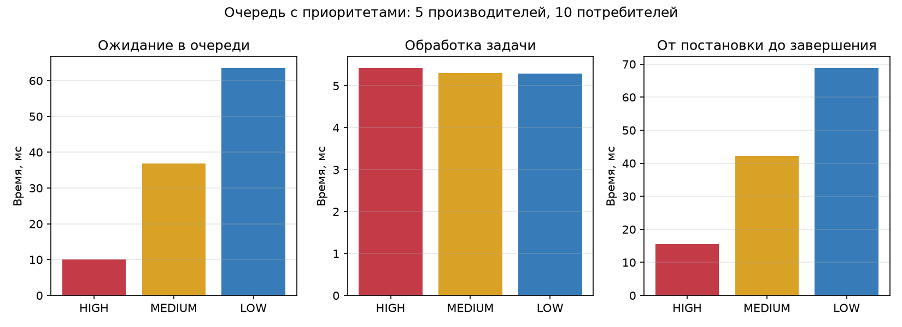
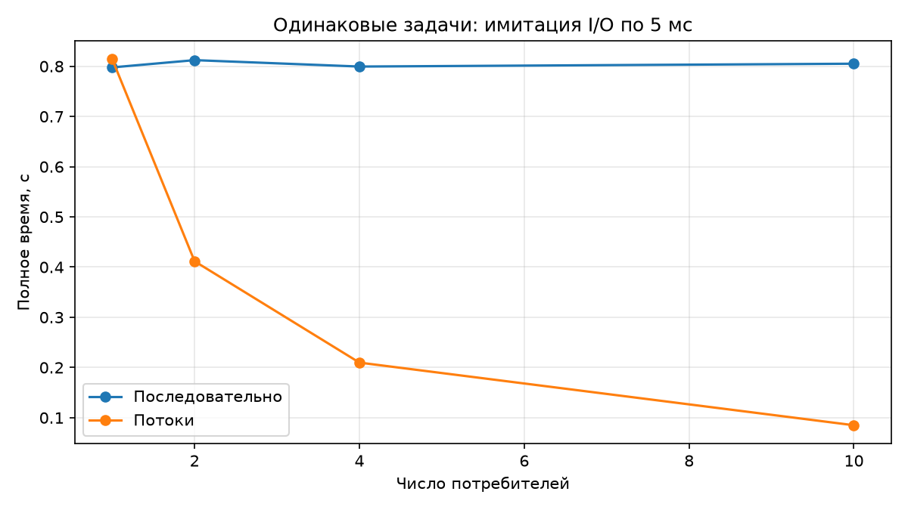

# Лабораторная работа №2 — вариант 22

Очередь с приоритетами для многопоточных приложений

Дата: 8 ноября 2026 года. ФИО, группа и преподаватель: поля титула для заполнения.

## 1. Задание

Вариант 22. Реализация очереди с приоритетами для многопоточных приложений. Тема — организация многопоточного приложения с приоритетной очередью. Цель — изучить применение потоков и условных переменных для реализации очереди с приоритетами.

Разработать PriorityQueue с атрибутом items и методами put(task,priority), get(). Создать Producer и Consumer — наследники Thread. Производители формируют задачи HIGH, MEDIUM, LOW; потребители обрабатывают задачи по приоритету. Создать пять производителей и десять потребителей. Использовать Condition, добавить логирование, измерить время обработки задач разных приоритетов и построить соответствующий график.

## 2. Введение

Приоритетная очередь позволяет срочным задачам, ожидающим обработки, обслуживаться раньше менее срочных. В многопоточном приложении требуется согласовать изменение списка между производителями и потребителями, исключить потерю задач и завершить ожидающие потоки. Работа исследует эти механизмы на конечном воспроизводимом наборе задач.

## 3. Теоретическая часть

Потоки одного процесса разделяют память, поэтому общий список требует синхронизации. Condition объединяет блокировку и ожидание изменения состояния: потребитель в цикле проверяет пустоту очереди и вызывает wait, освобождая блокировку; производитель под той же блокировкой добавляет элемент и вызывает notify. После пробуждения условие проверяется повторно. Это позволяет ждать без активного опроса [2].

Очередь хранится как min-heap в списке items. Запись содержит (приоритет, порядковый номер, задача, время постановки). HIGH=0, MEDIUM=1, LOW=2. Минимальный элемент извлекается первым. Уникальный счётчик обеспечивает FIFO для одинакового приоритета и исключает сравнение словарей задач. Операции добавления и извлечения имеют O(log M), M — число ожидающих элементов [3].

Приоритет применяется к задачам, которые уже находятся в очереди на момент get. Поздняя HIGH-задача не прерывает уже начатую LOW. При нескольких потребителях порядок завершения может отличаться от порядка извлечения. При бесконечной подаче HIGH возможен голод LOW; для его уменьшения можно добавить старение приоритета, но в этой работе набор задач конечный.

Измеряются W=t_start−t_enqueue — ожидание, C=t_finish−t_start — обслуживание, R=t_finish−t_enqueue=W+C — полный отклик. Для общей производительности S=T_seq/T_par, E=S/c, где c — число потребителей. Дополнительно сохраняется общее число потоков: c+5 производителей. Эти определения позволяют отличать эффект приоритета от скорости самой обработки.

## 4. Описание алгоритма

Схема: создать PriorityQueue → запустить потребителей → запустить пять производителей → дождаться всех производителей → поставить по одному None на потребителя → дождаться queue.join → выполнить Thread.join всех потребителей → проверить результаты → сохранить CSV. Потребитель выполняет: get → если None, завершение; иначе обработка и измерение → task_done в finally → следующий get.

Сигнал None получает приоритет бесконечность, поэтому не опережает обычные задачи. Счётчик unfinished увеличивается в put и уменьшается в task_done; join ждёт его обнуления. Condition защищает все изменения очереди и счётчика. Результаты каждого потребителя хранятся в собственном списке, а главный поток объединяет их после join.

Producer и Consumer наследуют Thread, имеют осмысленные имена и основной алгоритм в run. Потребитель перехватывает ошибку обработки, сохраняет её и всегда подтверждает задачу; после завершения потоков ошибка передаётся главному потоку. Поэтому ошибка одной задачи не оставляет queue.join в вечном ожидании.

## 5. Реализация программы

main.py содержит PriorityQueue, Producer, Consumer, генератор, одинаковую обработку последовательного и потокового режимов, CLI и CSV. Для вычислений используются стандартные модули Python: threading, heapq, time, logging и вспомогательные средства сохранения. Matplotlib нужен только для графиков. Полный код основной программы приведён в приложении.

По умолчанию каждый из пяти производителей создаёт 30 задач; всего 150, по 50 на каждый приоритет. Приоритеты в исходной последовательности чередуются LOW,HIGH,MEDIUM. Обработка включает одинаковое ожидание 5 мс (модель I/O) и возведение payload в квадрат для проверки результата. Такой workload выбран для наблюдения ожидания очереди и перекрытия I/O, он не является тестом CPU-масштабирования Python под GIL.

Лог содержит время, имя потока, уровень и сообщение. INFO показывает запуск и завершение потоков; DEBUG включает постановку и обработку каждой задачи. Проверяются конечная неотрицательная задержка, положительные количества и минимум три повтора; ошибки ввода-вывода логируются и приводят к ненулевому коду завершения.

## 6. Результаты экспериментов

Эксперименты выполнены 8 ноября 2026 года на Windows, Intel Core i5-11400F, CPython 3.13 с обычным GIL. Для каждого числа потребителей выполнены три повтора на тех же 150 задачах, пять производителей во всех режимах. Измеряется полное время последовательной обработки и полное время потокового запуска, включая создание потоков и синхронизацию. Генерация и сохранение CSV исключены. Логирование включено на INFO.

| Потребителей | T_seq, с | T_par, с | S | E | Проверка |
| --- | --- | --- | --- | --- | --- |
| 1 | 0.797776 | 0.814304 | 0.9797 | 0.9797 | Успешно |
| 2 | 0.812254 | 0.411612 | 1.9733 | 0.9867 | Успешно |
| 4 | 0.799476 | 0.209740 | 3.8117 | 0.9529 | Успешно |
| 10 | 0.805126 | 0.084948 | 9.4779 | 0.9478 | Успешно |

Во всех 12 измерениях результаты каждой задачи совпали с последовательной версией; потерь и дубликатов не обнаружено. Всего сохранено 1800 строк задач. Основной обязательный режим — пять производителей и десять потребителей; остальные режимы используются для сравнения зависимости времени от числа потребителей.

| Приоритет | Наблюдений | Ожидание, мс | Обработка, мс | Отклик, мс |
| --- | --- | --- | --- | --- |
| HIGH | 150 | 10.105 | 5.420 | 15.526 |
| MEDIUM | 150 | 36.901 | 5.304 | 42.205 |
| LOW | 150 | 63.486 | 5.297 | 68.783 |

Таблица приоритетов относится к десяти потребителям. 150 наблюдений каждого класса — это 50 задач × три повтора; все классы обрабатываются одной и той же функцией с одинаковым заданным ожиданием. Фактическое обслуживание немного превышает 5 мс из-за работы планировщика ОС и накладных расходов.





## 7. Анализ результатов

В обязательном режиме HIGH ожидает в среднем 10.105 мс, MEDIUM — 36.901 мс, LOW — 63.486 мс. При этом обслуживание всех классов около 5.3–5.4 мс. Следовательно, наблюдаемое преимущество высокого приоритета связано с более ранним выбором из накопленной очереди, а не с искусственно более короткими заданиями.

При десяти потребителях T_par=0.084948 с, T_seq=0.805126 с, S≈9.478, E≈0.948 по числу потребителей. Потоки проводят значительную часть времени в ожидании, и ожидания разных задач перекрываются. При одном потребителе потоковая инфраструктура немного увеличивает время. Рост числа производителей в этой серии не исследовался; полученная E не описывает эффективность всех пятнадцати служебных и рабочих потоков.

Замеры зависят от планировщика ОС и нагрузки; приоритет регулирует порядок извлечения доступных элементов, но не гарантирует сортировку всего потока задач по времени окончания. Длительная обработка LOW не прерывается. Эти свойства являются частью выбранной модели очереди и учитываются при проверке.

## 8. Проверка и контрольные вопросы

Пройдено пять автоматических тестов: заранее накопленные задачи выдаются HIGH→MEDIUM→LOW с FIFO для равных приоритетов; get ожидает на пустой очереди и просыпается после put; ошибочные приоритеты и лишний task_done отклоняются; 1500 задач с пятью производителями и десятью потребителями обрабатываются ровно один раз; ошибка обработки возвращается вызывающему коду без зависания. После стресс-теста рабочие потоки не остаются активными. Нулевое число задач в CLI завершается кодом 2.

Как реализовать очередь с приоритетами? Хранить элементы в min-heap с ключом приоритет и устойчивым порядковым номером, защитив доступ общей блокировкой. Какой механизм синхронизации подходит? Condition, потому что потребитель должен ожидать появления элемента и атомарно проверить состояние. Как расширить функциональность? Добавить ограничение вместимости с ожиданием свободного места, тайм-аут get, старение приоритетов, отмену задач или статистику нагрузки.

## 9. Выводы

Реализована очередь с приоритетами HIGH,MEDIUM,LOW, условной переменной Condition и классами Producer/Consumer. Выполнено требование пяти производителей и десяти потребителей, организованы корректное завершение и обработка ошибок. Получены реальные времена по приоритетам, CSV, логи и графики. Высокий приоритет уменьшает ожидание, а длительность обслуживания остаётся одинаковой. Все тесты и 12 экспериментальных запусков завершились корректно.

## Список литературы

1. Методические указания «ЛР2. Потоки», предоставленный файл; вариант 22 «Реализация очереди с приоритетами».

2. Python. threading — Thread-based parallelism, Condition objects. https://docs.python.org/3/library/threading.html (дата обращения: 08.11.2026).

3. Python. heapq — Heap queue algorithm; Priority Queue Implementation Notes. https://docs.python.org/3/library/heapq.html (дата обращения: 08.11.2026).

## Приложение. Полный текст основной программы

```python
"""ЛР2, вариант 22: очередь с приоритетами, 5 производителей и 10 потребителей."""
from __future__ import annotations

import argparse
import csv
import heapq
import json
import logging
import threading
import time
from pathlib import Path
from statistics import mean

ROOT = Path(__file__).resolve().parent
HIGH, MEDIUM, LOW = 0, 1, 2
PRIORITY_NAMES = {HIGH: 'HIGH', MEDIUM: 'MEDIUM', LOW: 'LOW'}


class PriorityQueue:
    """Потокобезопасная min-heap: меньший номер означает больший приоритет."""

    def __init__(self):
        """Создать очередь, условную переменную и счётчик незавершённых задач."""
        self.items = []
        self.condition = threading.Condition()
        self.sequence = 0
        self.unfinished = 0
        self.history = []

    def put(self, task, priority):
        """Добавить задачу; None с бесконечным приоритетом завершает потребителя."""
        if task is not None and priority not in PRIORITY_NAMES:
            raise ValueError('Допустимы приоритеты HIGH=0, MEDIUM=1, LOW=2')
        if task is None and priority != float('inf'):
            raise ValueError('Сигнал None должен иметь priority=inf')
        with self.condition:
            enqueued = time.perf_counter()
            heapq.heappush(self.items, (priority, self.sequence, task, enqueued))
            self.sequence += 1
            self.unfinished += 1
            self.condition.notify()

    def get(self):
        """Ожидать задачу в цикле; вернуть task, priority, момент enqueue и номер извлечения."""
        with self.condition:
            while not self.items:
                self.condition.wait()
            priority, sequence, task, enqueued = heapq.heappop(self.items)
            order = len(self.history)
            # История фиксируется под той же блокировкой, что извлечение.
            self.history.append((priority, sequence, None if task is None else task['id']))
            return task, priority, enqueued, order

    def task_done(self):
        """Подтвердить завершение ровно одной полученной задачи."""
        with self.condition:
            if self.unfinished <= 0:
                raise ValueError('task_done вызван слишком много раз')
            self.unfinished -= 1
            if self.unfinished == 0:
                self.condition.notify_all()

    def join(self):
        """Дождаться подтверждения всех поставленных задач и сигналов завершения."""
        with self.condition:
            while self.unfinished:
                self.condition.wait()


def process_task(task):
    """Смоделировать одинаковую I/O-задержку и вычислить проверяемый результат."""
    time.sleep(task['service_seconds'])
    return task['payload'] ** 2


class Producer(threading.Thread):
    """Именованный производитель задач трёх приоритетов."""

    def __init__(self, number, tasks, queue, logger):
        """Передать производителю его детерминированный набор задач."""
        super().__init__(name=f'Producer-{number}')
        self.tasks, self.queue, self.logger = tasks, queue, logger
        self.error = None

    def run(self):
        """Поместить задачи в очередь и сохранить исключение для главного потока."""
        self.logger.info('Начало генерации %d задач', len(self.tasks))
        try:
            for task in self.tasks:
                self.queue.put(task, task['priority'])
                self.logger.debug('Поставлена задача %s, %s', task['id'], PRIORITY_NAMES[task['priority']])
        except Exception as exc:
            self.error = str(exc)
            self.logger.exception('Ошибка производителя')
        self.logger.info('Производитель завершён')


class Consumer(threading.Thread):
    """Именованный потребитель, завершающийся после сигнала None."""

    def __init__(self, number, queue, logger):
        """Создать независимый журнал результатов потока."""
        super().__init__(name=f'Consumer-{number}')
        self.queue, self.logger = queue, logger
        self.records = []
        self.errors = []

    def run(self):
        """Извлекать по приоритету, измерять ожидание и обработку, подтверждать задачи."""
        self.logger.info('Потребитель запущен')
        while True:
            task, priority, enqueued, order = self.queue.get()
            try:
                if task is None:
                    break
                started = time.perf_counter()
                result = process_task(task)
                finished = time.perf_counter()
                self.records.append(dict(task_id=task['id'], priority=PRIORITY_NAMES[priority],
                                         consumer=self.name, dequeue_order=order,
                                         wait_seconds=started - enqueued,
                                         service_seconds=finished - started,
                                         response_seconds=finished - enqueued, result=result))
                self.logger.debug('Обработана задача %s, %s', task['id'], PRIORITY_NAMES[priority])
            except Exception as exc:
                self.errors.append(str(exc))
                self.logger.exception('Ошибка обработки задачи %s', task['id'])
            finally:
                self.queue.task_done()
        self.logger.info('Потребитель завершён')


def create_tasks(producers=5, tasks_per_producer=30, service_seconds=.005):
    """Создать воспроизводимые задачи LOW, HIGH, MEDIUM одинаковой длительности."""
    return [[dict(id=f'{p + 1}-{i + 1}', priority=(LOW, HIGH, MEDIUM)[i % 3],
                  payload=p * tasks_per_producer + i + 1, service_seconds=service_seconds)
             for i in range(tasks_per_producer)] for p in range(producers)]


def sequential_computation(groups):
    """Обработать те же задачи одним потоком с устойчивой сортировкой по приоритету."""
    tasks = sorted((task for group in groups for task in group), key=lambda t: t['priority'])
    return {task['id']: process_task(task) for task in tasks}


def parallel_computation(groups, consumers, logger):
    """Создать потоки, дождаться производителей, затем завершить потребителей сигналами."""
    queue = PriorityQueue()
    workers = [Consumer(i + 1, queue, logger) for i in range(consumers)]
    producers = [Producer(i + 1, group, queue, logger) for i, group in enumerate(groups)]
    started_threads = []
    try:
        for thread in workers + producers:
            thread.start()
            started_threads.append(thread)
    finally:
        # Даже при частичном отказе запуска сначала завершаем живых производителей.
        for thread in started_threads:
            if isinstance(thread, Producer):
                thread.join()
        live_workers = [thread for thread in started_threads if isinstance(thread, Consumer)]
        for _ in live_workers:
            queue.put(None, float('inf'))
        if live_workers:
            queue.join()
        for thread in live_workers:
            thread.join()
    errors = [p.error for p in producers if p.error] + [e for w in workers for e in w.errors]
    if errors:
        raise RuntimeError('; '.join(errors))
    records = sorted((r for worker in workers for r in worker.records), key=lambda r: r['dequeue_order'])
    return records


def setup_logging(level):
    """Настроить время, имя потока, уровень и запись в файл и консоль."""
    (ROOT / 'results').mkdir(exist_ok=True)
    logger = logging.getLogger('lab2.priority_queue')
    logger.setLevel(getattr(logging, level))
    for handler in logger.handlers[:]:
        handler.close()
        logger.removeHandler(handler)
    formatter = logging.Formatter('%(asctime)s - %(threadName)s - %(levelname)s - %(message)s')
    for handler in (logging.FileHandler(ROOT / 'results' / 'logs.log', mode='w', encoding='utf-8'),
                    logging.StreamHandler()):
        handler.setFormatter(formatter)
        logger.addHandler(handler)
    return logger


def write_csv(path, rows):
    """Сохранить измерения с заголовком."""
    with path.open('w', encoding='utf-8', newline='') as file:
        writer = csv.DictWriter(file, fieldnames=list(rows[0]))
        writer.writeheader()
        writer.writerows(rows)


def main():
    """Провести не менее трёх повторов и сохранить общие и приоритетные метрики."""
    parser = argparse.ArgumentParser(description='ЛР2, вариант 22: приоритетная очередь')
    parser.add_argument('--producers', type=int, default=5)
    parser.add_argument('--threads', '--consumers', dest='threads', type=int, default=10)
    parser.add_argument('--tasks', type=int, default=30, help='Число задач на одного производителя')
    parser.add_argument('--service-ms', type=float, default=5.)
    parser.add_argument('--repeats', type=int, default=3)
    parser.add_argument('--benchmark', action='store_true', help='Проверить 1, 2, 4 и 10 потребителей')
    parser.add_argument('--log', choices=['DEBUG', 'INFO', 'WARNING', 'ERROR'], default='INFO')
    args = parser.parse_args()
    if min(args.producers, args.threads, args.tasks) < 1 or args.repeats < 3 or not 0 <= args.service_ms < float('inf'):
        parser.error('Нужны положительные количества, repeats >= 3 и конечный service-ms >= 0')
    logger = setup_logging(args.log)
    try:
        groups = create_tasks(args.producers, args.tasks, args.service_ms / 1000)
        raw, details, summaries, priorities = [], [], [], []
        counts = sorted(set([1, 2, 4, args.threads])) if args.benchmark else [args.threads]
        for consumers in counts:
            cases = []
            for repeat in range(1, args.repeats + 1):
                start = time.perf_counter()
                seq = sequential_computation(groups)
                t1 = time.perf_counter() - start
                start = time.perf_counter()
                records = parallel_computation(groups, consumers, logger)
                tp = time.perf_counter() - start
                correct = len(records) == len(seq) and len({r['task_id'] for r in records}) == len(seq) and \
                          {r['task_id']: r['result'] for r in records} == seq
                if not correct:
                    raise RuntimeError('Проверка результатов: ОШИБКА')
                row = dict(threads=consumers, producers=args.producers, total_threads=consumers + args.producers,
                           tasks=len(seq), repeat=repeat, time_seq=t1, time_par=tp,
                           speedup=t1 / tp, efficiency=t1 / tp / consumers, correct=correct)
                raw.append(row)
                cases.append(row)
                details.extend(dict(threads=consumers, repeat=repeat, **r) for r in records)
            t1, tp = mean(r['time_seq'] for r in cases), mean(r['time_par'] for r in cases)
            summaries.append(dict(threads=consumers, producers=args.producers, tasks=len(seq), repeats=args.repeats,
                                  time_seq=t1, time_par=tp, speedup=t1 / tp,
                                  efficiency=t1 / tp / consumers, correct=True))
            for priority in PRIORITY_NAMES.values():
                selected = [r for r in details if r['threads'] == consumers and r['priority'] == priority]
                if selected:
                    priorities.append(dict(threads=consumers, priority=priority, count=len(selected),
                                           mean_wait_seconds=mean(r['wait_seconds'] for r in selected),
                                           mean_service_seconds=mean(r['service_seconds'] for r in selected),
                                           mean_response_seconds=mean(r['response_seconds'] for r in selected)))
            print(json.dumps(summaries[-1], ensure_ascii=False), flush=True)
        for name, rows in [('results', raw), ('summary', summaries), ('tasks', details), ('priority_summary', priorities)]:
            write_csv(ROOT / 'results' / f'{name}.csv', rows)
        (ROOT / 'results' / 'parameters.json').write_text(json.dumps(vars(args), ensure_ascii=False, indent=2), encoding='utf-8')
    except (OSError, RuntimeError, ValueError) as exc:
        logger.exception('Ошибка эксперимента: %s', exc)
        raise SystemExit(1) from exc


if __name__ == '__main__':
    main()
```
