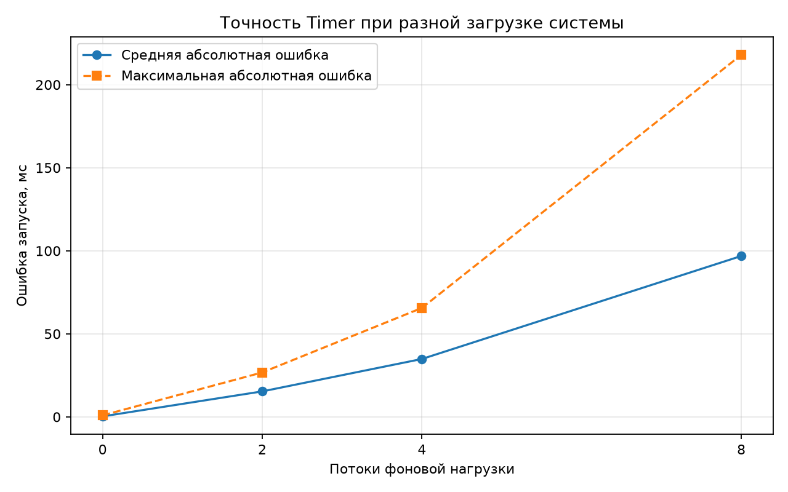
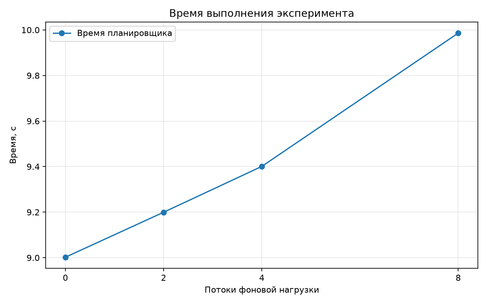

# Лабораторная работа №2

## Титульный лист

**Дисциплина:** Параллельное программирование  
**Тема:** Организация отложенного выполнения задач с использованием Timer  
**Вариант:** 24  
**Работа:** Реализация таймера с отложенным запуском на Python

## Задание

Необходимо разработать планировщик отложенных задач. Требования варианта:

1. Создать класс `Scheduler` с методами `schedule(task, delay)`, `run()` и `cancel(task)`.
2. Создать класс `Task` с названием, задержкой и функцией.
3. Создать 10 задач с задержками от 1 до 10 секунд.
4. Использовать `threading.Timer`.
5. Реализовать отмену задачи.
6. Добавить логирование выполнения.
7. Измерить точность таймера.
8. Построить график зависимости точности от загрузки системы.

## Введение

Отложенный запуск нужен, когда действие должно произойти через заданный интервал времени: например, при планировании уведомлений, повторных попыток или фоновых операций. В Python класс `threading.Timer` представляет поток, который начинает выполнение функции после задержки. В работе исследуется точность такого механизма и влияние фоновой нагрузки.

## Теоретическая часть

`Timer` является специализированным потоком `Thread`. При вызове `start()` он ждёт заданный интервал и затем вызывает функцию. Отмена выполняется методом `cancel()` до наступления момента запуска. Точность оценивается разностью между фактическим и запланированным временем:

`error_i = |(t_actual - t_scheduled) - delay_i|`.

Средняя ошибка:

`error_mean = (1 / n) * sum(error_i)`.

Для каждого уровня нагрузки выполняются три независимых повтора. Фоновая нагрузка создаётся отдельными классами-наследниками `Thread`, которые выполняют короткие вычислительные блоки.

## Описание алгоритма

`Scheduler.schedule()` записывает момент планирования, создаёт `threading.Timer`, присваивает ему имя, делает его daemon-потоком и запускает. Функция Timer проверяет флаг отмены, выполняет `Task.function`, фиксирует время фактического старта и выставляет `Event` завершения.

`Scheduler.cancel()` защищён `RLock`: он отмечает задачу отменённой, вызывает `Timer.cancel()` и устанавливает событие завершения, чтобы `run()` не зависал. `Scheduler.run()` ждёт события всех задач.

Последняя из десяти задач в каждом опыте отменяется до запуска. Поэтому ожидаемое число выполненных задач равно 9.

## Реализация

- [main.py](./main.py) содержит `Task`, `Scheduler`, `LoadWorker`, замеры, CLI и запись CSV.
- [plot_graphs.py](./plot_graphs.py) строит графики ошибки и времени.
- `results/logs.log` содержит timestamp, имя потока, уровень и сообщение.
- [results/results.csv](./results/results.csv) содержит все 12 отдельных замеров.
- [results/summary.csv](./results/summary.csv) содержит средние значения по уровням нагрузки.

Использованные механизмы синхронизации: `RLock` защищает список задач и состояние планировщика, `Lock` защищает состояние отдельной задачи, `Event` сообщает о завершении Timer-потока.

## Результаты экспериментов

Для каждого уровня нагрузки выполнено 3 повторения. Во всех случаях 9 задач выполнены, одна задача отменена, `correct=True`.

| Фоновые потоки | T_seq, с | T_par, с | S | Средняя ошибка, мс | Максимальная ошибка, мс |
|---:|---:|---:|---:|---:|---:|
| 0 | 55.000 | 9.002 | 6.110 | 0.323 | 0.925 |
| 2 | 55.000 | 9.200 | 5.979 | 15.353 | 26.764 |
| 4 | 55.000 | 9.401 | 5.851 | 34.868 | 65.602 |
| 8 | 55.000 | 9.986 | 5.508 | 96.862 | 217.983 |

`T_seq = 55 с` — сумма задержек 1+2+...+10, то есть условная последовательная модель. `T_par` — фактическое время ожидания планировщика до выполнения задач с задержками 1..9, так как десятисекундная задача отменяется.

## Графики





## Анализ результатов

Без фоновой нагрузки средняя ошибка составляет около `0.32 мс`, что показывает высокую точность запуска в спокойной системе. При 2, 4 и 8 потоках нагрузки средняя ошибка возрастает до `15.35`, `34.87` и `96.86 мс`. Максимальная ошибка растёт ещё сильнее, поскольку планирование зависит от доступности процессора и очереди потоков ОС.

Одновременно фактическое время эксперимента увеличивается с `9.002` до `9.986 с`. Это подтверждает, что Timer сохраняет отложенный характер запуска, но не гарантирует жёсткую временную точность: указанная задержка является минимальным ориентиром, а не deadline.

В сравнении с [результатами первой лабораторной](../Lab_01_variant_24/results.csv) здесь используется модель потоков для I/O-подобного ожидания времени. В первой работе основными накладными расходами были MPI-коммуникации, здесь — планирование потоков и конкуренция за CPU. Поэтому график второй работы показывает точность и задержку, а не масштабирование матричных вычислений.

## Ответы на контрольные вопросы

**Как реализовать отложенное выполнение?**  
Создать `threading.Timer(delay, function)`, запустить его методом `start()` и дождаться завершения через событие или `join()`.

**Какой механизм синхронизации использован?**  
`RLock` защищает коллекцию задач планировщика, `Lock` защищает состояние отдельной задачи, `Event` сообщает `Scheduler.run()` о завершении. Для самой задержки используется `Timer`.

**Как улучшить точность таймера?**  
Уменьшить нагрузку, использовать монотонные часы `perf_counter()`, не выполнять тяжёлую работу внутри callback, применять отдельный планировщик с приоритетной очередью и компенсировать накопленное отклонение. Для real-time гарантий обычный Python `Timer` не предназначен.

## Выводы

Реализован кроссплатформенный планировщик на Python с десятью отложенными задачами, отменой, логированием и измерением точности. Все эксперименты выполнены по три раза, результаты сохранены в CSV. При увеличении нагрузки с 0 до 8 потоков средняя ошибка Timer выросла примерно в 300 раз — с `0.323` до `96.862 мс`. Следовательно, `threading.Timer` удобен для обычного отложенного выполнения, но его точность зависит от загрузки системы.

## Приложение: запуск

```powershell
python main.py
python plot_graphs.py
python main.py --single --tasks 10 --max-delay 10 --loads 4 --log DEBUG
```
